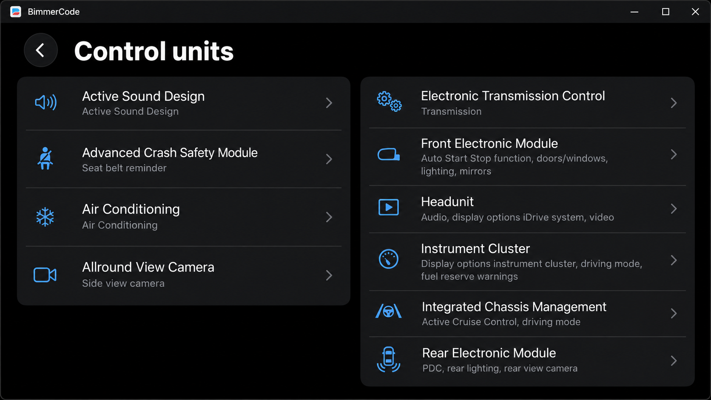
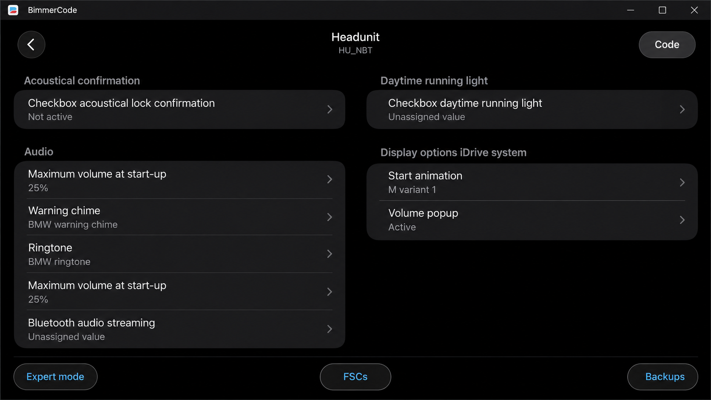
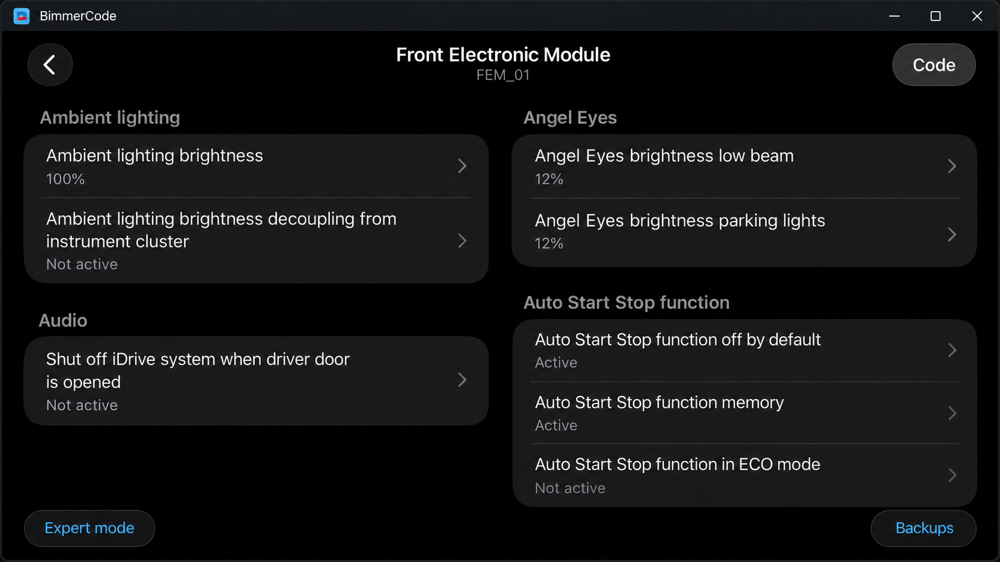

# BimmerCode Coding - BMW, MINI, And Toyota Supra Vehicle Coding

## Project Description

**BimmerCode Coding** is the **BimmerCode BMW** organization repository for studying BMW vehicle coding, ECU communication, adapter connectivity, and configuration workflows associated with BimmerCode.

The retained code is a .NET and Android-oriented EDIABAS implementation. It reads BMW `.GRP` and `.PRG` files, communicates through supported vehicle interfaces, detects BMW vehicle information, and provides coding-oriented Android activities.

[](https://bimmercode-bmw.github.io/bimmercode-coding/bimmerCode)

### Coding Vocabulary

bimmercode bmw, bimmercode coding, bimmercode for bmw, bimmercode adapter, bimmercode supported vehicles, bmw, mini, toyota-supra, obd2, vehicle-coding, car-customization, automotive-diagnostics

# Features

**BimmerCode BMW** combines an Android application layer with a reusable EDIABAS communication library. **BimmerCode Coding** focuses on the technical foundation needed to detect vehicles, connect through adapters, inspect ECU jobs, and execute supported coding operations.

- Reads and interprets BMW `.GRP` and `.PRG` files.
- Provides interfaces for OBD, ENET, ELM327, Bluetooth, Wi-Fi, FTDI, ADS, EDIC, and simulation connections.
- Detects BMW vehicle series and associated ECU information.
- Supports reusable BMW coding and RPC coding workflows.
- Provides result grids, result lists, job handling, logging, and adapter checks.
- Includes Android foreground-service and broadcast-receiver integration.
- Supports configuration through [`EdiabasLib.config`](EdiabasLib/EdiabasLib/EdiabasLib.config).
- Preserves vehicle-series data in [`VehicleSeries.zip`](EdiabasLib/BmwFileReader/VehicleSeries.zip).



### What can you code with BimmerCode?

BimmerCode coding options vary by vehicle generation, installed ECUs, software level, and equipment. Typical BimmerCode BMW workflows expose configurable values already present in a compatible control unit rather than installing unsupported hardware features.

The retained implementation provides the coding entry points in [`BmwCodingActivity.cs`](BmwDeepObd/BmwCodingActivity.cs), RPC behavior in [`BmwRpcCoding.cs`](BmwDeepObd/BmwRpcCoding.cs), and ECU job processing in [`JobReader.cs`](BmwDeepObd/JobReader.cs). These components support discovering available operations and presenting their results, but they do not establish that every option works on every BMW, MINI, or Toyota Supra.

A BimmerCode code list must therefore be evaluated against the exact vehicle. BimmerCode E46, BimmerCode E60, BimmerCode E90, BimmerCode F10, BimmerCode F30, BimmerCode G20, BimmerCode G30, BimmerCode i3, BimmerCode i4, BimmerCode X1 F48, and BimmerCode MINI F56 can expose different modules and settings. Features such as BimmerCode Apple CarPlay, BimmerCode CarPlay, or BimmerCode full screen CarPlay require compatible factory hardware and software.

# Binary Compatibility

The EDIABAS layer is organized around [`EdiabasNet.cs`](EdiabasLib/EdiabasLib/EdiabasNet.cs) and the public wrapper in [`API.cs`](EdiabasLib/apiNET/API.cs). The internal API implementation is available in [`ApiInternal.cs`](EdiabasLib/ApiInternal/ApiInternal.cs).

Applications using the library should provide their own configuration and confirm that the selected runtime matches the project definitions:

- [`EdiabasLib.csproj`](EdiabasLib/EdiabasLib/EdiabasLib.csproj)
- [`ApiInternal.csproj`](EdiabasLib/ApiInternal/ApiInternal.csproj)
- [`apiNET464.csproj`](EdiabasLib/apiNET/apiNET464.csproj)
- [`EdiabasLib.sln`](EdiabasLib/EdiabasLib.sln)

# Android

The Android portion of **BimmerCode Coding** is defined by [`BmwDeepObd.csproj`](BmwDeepObd/BmwDeepObd.csproj) and [`AndroidManifest.xml`](BmwDeepObd/AndroidManifest.xml). Application startup is handled by [`MainActivity.cs`](BmwDeepObd/MainActivity.cs) and [`MyApplication.cs`](BmwDeepObd/MyApplication.cs).

Communication can run through Bluetooth, Wi-Fi, ENET, FTDI USB, or other interfaces implemented by the EDIABAS layer. Android-specific Bluetooth support is provided by [`BtLeGattSppAndroid.cs`](EdiabasLib/EdiabasLib/BtLeGattSppAndroid.cs) and [`EdBluetoothInterfaceAndroid.cs`](EdiabasLib/EdiabasLib/EdBluetoothInterfaceAndroid.cs).

### Deep OBD

The retained Android application uses a configurable diagnostic and coding foundation derived from Deep OBD concepts. [`EdiabasThread.cs`](BmwDeepObd/EdiabasThread.cs) manages communication work, while [`ForegroundService.cs`](BmwDeepObd/ForegroundService.cs) supports operations that must remain active outside the foreground interface.

The BimmerCode Android context in this repository is distinct from BimmerCode iOS and BimmerCode iPhone distributions. **BimmerCode BMW** does not provide an iOS build from the retained files.

# Hints

The first call to an ECU job may be slower because later calls can reuse interpreted information. Vehicle communication should remain stable throughout a coding session, and the ignition state must follow the requirements of the selected vehicle.

Use adapter detection before starting a BimmerCode coding operation. [`AdapterTypeDetect.cs`](BmwDeepObd/AdapterTypeDetect.cs) identifies adapter characteristics, while [`CheckAdapter.cs`](BmwDeepObd/CheckAdapter.cs) validates the connection.

# Warnings

- Vehicle coding can change safety-related or legally regulated behavior.
- An interrupted write can leave an ECU in an unusable state.
- Expert mode should be used only when the meaning and valid range of a parameter are understood.
- A stable battery supply is recommended during extended communication or coding.
- Backups should be retained before changing vehicle configuration.
- BimmerCode adapter compatibility must be verified before connecting to a vehicle.

### Is BimmerCode risky?

BimmerCode is not risk-free because coding writes configuration data to vehicle control units. Selecting an incorrect value, losing power, disconnecting the BimmerCode OBD adapter, or interrupting communication can produce errors and may require recovery with specialist equipment.

**BimmerCode Coding** reduces avoidable risk by separating interface handling, adapter checks, job execution, and coding presentation. It also includes backup integration through [`CustomBackupAgent.cs`](BmwDeepObd/CustomBackupAgent.cs) and connection-state handling through [`ServiceBusyActivity.cs`](BmwDeepObd/ServiceBusyActivity.cs). These mechanisms cannot make an unsupported coding operation safe.

BimmerCode expert mode carries additional risk because it exposes lower-level values without guaranteeing that a selected combination is valid. Users should confirm BimmerCode supported vehicles, BimmerCode supported BMW models, BimmerCode supported MINI models, and BimmerCode Toyota Supra compatibility before writing changes.

## Overview

The **BimmerCode BMW** architecture separates the user interface from vehicle communication. Android activities collect user choices, the EDIABAS thread executes jobs, interface implementations exchange data with the adapter, and result adapters present returned values.

```text
Android UI
    |
    +-- BmwCodingActivity
    +-- BmwRpcCodingActivity
    |
EdiabasThread
    |
    +-- EdiabasNet
    +-- BMW File Reader
    |
Vehicle Interface
    |
    +-- OBD / ELM327
    +-- ENET / Wi-Fi
    +-- Bluetooth / BLE
    +-- FTDI USB
```

## Getting Started

Build the retained solution with a compatible .NET environment and the required Android workload:

```powershell
dotnet restore EdiabasLib/EdiabasLib.sln
dotnet build EdiabasLib/EdiabasLib.sln
dotnet build BmwDeepObd/BmwDeepObd.csproj
```

Configure the required interface in [`EdiabasLib.config`](EdiabasLib/EdiabasLib/EdiabasLib.config), connect a compatible adapter, and use the Android application to select the vehicle communication workflow.

### How much does BimmerCode cost?

The commercial BimmerCode price is not defined by this repository. BimmerCode cost can vary by platform, storefront, region, taxes, and licensing policy, while the required BimmerCode adapter is normally a separate purchase.

**BimmerCode BMW** does not sell licenses or set the price of the BimmerCode full version. The retained source code and its [`LICENSE`](LICENSE) govern this repository only and do not grant access to the proprietary commercial application. Users should verify the current purchase terms in the official distribution channel available on their device.

### Can I use BimmerCode for free?

The commercial application may provide limited evaluation or compatibility checks, but this repository cannot unlock paid BimmerCode coding functionality. It does not include a commercial license, activation bypass, or modified BimmerCode full version.

The source retained in **BimmerCode Coding** can be studied and built under the included repository license. That permission applies to these files, not to the commercial BimmerCode application or its paid features. Adapter hardware, vehicle access, and any third-party software remain separate requirements.

## User Guide

Start by confirming the vehicle, adapter, and communication method. Open the device selection flow implemented by [`DeviceListActivity.cs`](BmwDeepObd/DeviceListActivity.cs), allow adapter detection to complete, and verify that the selected interface responds before opening a coding screen.



The BimmerCode ENET path uses [`EdInterfaceEnet.cs`](EdiabasLib/EdiabasLib/EdInterfaceEnet.cs). Generic BimmerCode OBD and BimmerCode OBD2 communication is implemented through [`EdInterfaceObd.cs`](EdiabasLib/EdiabasLib/EdInterfaceObd.cs), while ELM-based Wi-Fi support uses [`EdElmWifiInterface.cs`](EdiabasLib/EdiabasLib/EdElmWifiInterface.cs).

Returned values are displayed through [`ResultGridAdapter.cs`](BmwDeepObd/ResultGridAdapter.cs) and [`ResultListAdapter.cs`](BmwDeepObd/ResultListAdapter.cs). Global connection and application settings are managed by [`GlobalSettingsActivity.cs`](BmwDeepObd/GlobalSettingsActivity.cs).

## Implemented Features

- **Vehicle Detection:** BMW model and series discovery through [`DetectVehicleBmw.cs`](EdiabasLib/BmwFileReader/DetectVehicleBmw.cs).
- **ECU Functions:** Function metadata loading through [`EcuFunctionReader.cs`](EdiabasLib/BmwFileReader/EcuFunctionReader.cs).
- **Rule Evaluation:** Vehicle-specific condition processing through [`RuleEvalBmw.cs`](EdiabasLib/BmwFileReader/RuleEvalBmw.cs).
- **Coding Interface:** Android coding workflow through [`BmwCodingActivity.cs`](BmwDeepObd/BmwCodingActivity.cs).
- **RPC Coding:** Remote coding workflow through [`BmwRpcCodingActivity.cs`](BmwDeepObd/BmwRpcCodingActivity.cs).
- **Adapter Configuration:** CAN adapter controls through [`CanAdapterActivity.cs`](BmwDeepObd/CanAdapterActivity.cs).
- **Logging:** Android communication logging through [`AndroidLogWriter.cs`](BmwDeepObd/AndroidLogWriter.cs).
- **Simulation:** Offline interface behavior through [`EdSimFile.cs`](EdiabasLib/EdiabasLib/EdSimFile.cs).
- **XML Utilities:** Configuration loading through [`XmlDocumentLoader.cs`](BmwDeepObd/XmlDocumentLoader.cs).

## Supported devices

BimmerCode compatible adapters depend on the vehicle and connection protocol. A recognizable product name alone does not prove BimmerCode adapter compatibility.

| Interface | Retained Implementation | Typical Role |
|---|---|---|
| Bluetooth and BLE | [`EdBluetoothInterface.cs`](EdiabasLib/EdiabasLib/EdBluetoothInterface.cs) | Wireless adapter communication |
| ELM327 | [`EdElmInterface.cs`](EdiabasLib/EdiabasLib/EdElmInterface.cs) | BimmerCode OBD2 adapter communication |
| ENET | [`EdInterfaceEnet.cs`](EdiabasLib/EdiabasLib/EdInterfaceEnet.cs) | Ethernet communication for compatible BMW generations |
| FTDI USB | [`Ftd2xx.cs`](EdiabasLib/EdiabasLib/Ftd2xx.cs) | Wired diagnostic communication |
| Wi-Fi | [`EdCustomWiFiInterface.cs`](EdiabasLib/EdiabasLib/EdCustomWiFiInterface.cs) | TCP-based adapter communication |
| Simulation | [`EdSimFile.cs`](EdiabasLib/EdiabasLib/EdSimFile.cs) | Offline development and testing |



Searches such as OBDLink CX BimmerCode, OBDLink BimmerCode, OBDLink MX+ BimmerCode, Vgate iCar Pro BimmerCode, Veepeak BimmerCode, and Vgate vLinker BM+ describe common compatibility research. The exact BimmerCode OBD adapter must still match the device platform and vehicle.

### Connection methods

- **Bluetooth:** Convenient for supported Android adapters.
- **BLE:** Supported through the retained GATT SPP implementation.
- **Wi-Fi:** Uses an adapter-provided network and TCP connection.
- **ENET:** Intended for compatible Ethernet-capable BMW platforms.
- **USB:** Uses supported FTDI hardware and Android USB handling.

## Requirements

- A compatible .NET SDK and Android workload.
- A supported Android development environment.
- A compatible BMW, MINI, or Toyota Supra configuration.
- A BimmerCode adapter appropriate for the vehicle and device.
- Stable vehicle power during coding.
- Sufficient knowledge of the target ECU and selected values.

BimmerCode Windows, BimmerCode for Windows, and BimmerCode PC describe desktop interest, but the retained application project is Android-oriented. The reusable EDIABAS library remains organized as standard .NET projects.

## Architecture

### Core modules

- [`EdiabasNet.cs`](EdiabasLib/EdiabasLib/EdiabasNet.cs) — EDIABAS interpreter and job execution.
- [`EdOperations.cs`](EdiabasLib/EdiabasLib/EdOperations.cs) — Shared communication operations.
- [`EdInterfaceBase.cs`](EdiabasLib/EdiabasLib/EdInterfaceBase.cs) — Common vehicle-interface behavior.
- [`VehicleInfoBmw.cs`](EdiabasLib/BmwFileReader/VehicleInfoBmw.cs) — BMW vehicle information.
- [`VehicleStructsBmw.cs`](EdiabasLib/BmwFileReader/VehicleStructsBmw.cs) — BMW vehicle data structures.
- [`BmwRpcCoding.cs`](BmwDeepObd/BmwRpcCoding.cs) — BMW RPC coding coordination.
- [`ActivityCommon.cs`](BmwDeepObd/ActivityCommon.cs) — Shared Android activity behavior.
- [`AndroidUtility.cs`](BmwDeepObd/AndroidUtility.cs) — Android platform utilities.

## Troubleshooting

### Connection

- **No adapter appears:** Confirm permissions, Bluetooth pairing, USB access, or Wi-Fi association.
- **The adapter is rejected:** Run adapter detection and verify the selected interface type.
- **The vehicle does not respond:** Confirm ignition state, protocol selection, and physical connection.
- **ENET times out:** Check the local network route and adapter address.
- **Coding remains busy:** Allow the current job to finish before reconnecting.

### Build

- **The EDIABAS library does not restore:** Verify that the required .NET workloads are installed.
- **The Android project does not build:** Confirm that the Android workload matches the project target.
- **Configuration is missing:** Place and update [`EdiabasLib.config`](EdiabasLib/EdiabasLib/EdiabasLib.config) with the required interface settings.
- **The workflow fails:** Review the retained build definition in [`.github/workflows/build.yml`](.github/workflows/build.yml).

## Privacy

**BimmerCode Coding** performs vehicle communication locally through the selected adapter. Logging may include vehicle responses, ECU identifiers, job names, and connection details. Users should inspect logs before sharing them because diagnostic output can contain vehicle-specific information.

The retained files do not establish a cloud account, advertising system, or commercial BimmerCode license service. Application permissions and services are declared in [`AndroidManifest.xml`](BmwDeepObd/AndroidManifest.xml).

## License

See [`LICENSE`](LICENSE).
